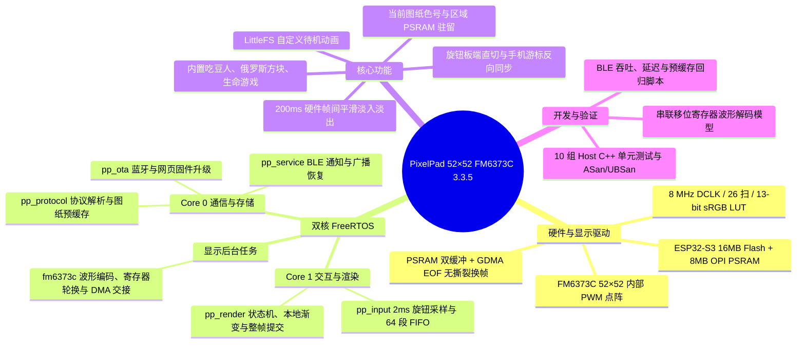
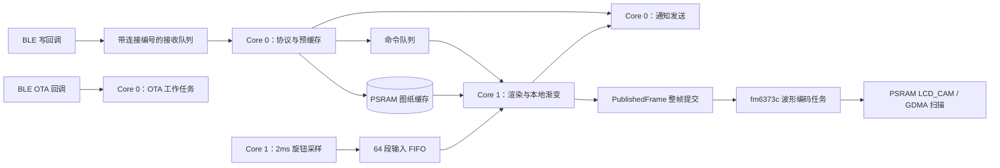

# PixelPad RTOS（ESP32-S3，52×52 FM6373C）

这是 PixelPad 52×52 点阵屏（**ESP32-S3 + FM6373C 列驱动**）的开源固件工程，刷入后即可直接用配套 App 蓝牙连接。

本分支面向采用 **FM6373C**（带内部 SRAM 与 13 位硬件 PWM 的 16 通道恒流驱动）的新批次灯板，沿用原有 52×52 PCB 走线与外部行译码电路。底层同样基于 **ESP-IDF FreeRTOS** 与 Arduino 2.0.17 兼容层，当前版本为 **3.3.5**，支持当前图纸 PSRAM 预缓存、本地旋钮毫秒级切换、200 ms 帧间平滑渐变、sRGB 到线性光强的 13 位 Gamma 查表，以及蓝牙/HTTP OTA 传输互斥。

> 如果你手头使用的是 **FM6124**（标准 HUB75 位平面驱动）版本的 52×52 灯板，请切换到仓库的 `main` 分支编译对应固件。

如果你想了解各个版本的演进细节和实板测试数据，可以翻看 `docs/` 与驱动目录下的记录：
- [当前图纸驻留与灯板本地旋钮](docs/CURRENT_ARTWORK_CACHE_3.3.5.md)（3.3.5）
- [旋钮丢步与响应修复](docs/ROTARY_INPUT_FIX_3.3.4.md)（3.3.4）
- [色号与颜色区域本地过渡](docs/LOCAL_FRAME_FADE_3.3.3.md)（3.3.3）
- [FM6373C sRGB 颜色曲线修正](docs/COLOR_TRANSFER_FIX_3.3.2.md)（3.3.2）
- [蓝牙小包传图与超时修复](docs/BLE_TRANSFER_FIX_3.3.1.md)（3.3.1）
- [FM6373C FreeRTOS 迁移说明](docs/RTOS_UPGRADE.md)（3.3.0）
- [FM6373C 底层驱动与时序说明](lib/led/FM6373C.md)

## 分支说明

| 分支 | 目标硬件与驱动 | 当前版本 |
| --- | --- | --- |
| `main` | ESP32-S3 + 52×52 **FM6124**（HUB75 I2S DMA 位平面驱动） | RTOS 3.2.7 |
| `52x52-fm6373c` | ESP32-S3 + 52×52 **FM6373C**（8 MHz 内部 PWM + PSRAM LCD_CAM/GDMA 驱动） | RTOS 3.3.5 |

## 架构概览与目录结构



| 目录/文件 | 内容 |
| --- | --- |
| `src/main.cpp` | 固件入口、任务启动与 OTA 启动自检（含 `ledDisplay.isReady()` 校验） |
| `include/` | 协议边界、接收超时和公共头文件 |
| `lib/runtime/` | 双核 FreeRTOS 任务调度、图纸旋钮预缓存（`RotaryFrameCache`）与待机存储 |
| `lib/led/` | FM6373C 协议波形编码、LCD_CAM/GDMA 双缓冲、sRGB 13 位查表与帧过渡 |
| `lib/Bluetooth/` | BLE NUS 通信、命令解析与连接会话隔离 |
| `lib/OTA/` | BLE/HTTP OTA 升级与共享传输互斥门控（`TransferGate`） |
| `lib/button/` | 2 ms 旋钮/按键采样、64 段有序 FIFO 与输入统计 |
| `lib/app/`、`lib/game/` | 设备主状态机、待机画面及生命游戏/吃豆人/流沙俄罗斯方块 |
| `test/`、`tools/` | 主机端 C++ 回归测试与 BLE 实板压测脚本 |
| `BLE_PROTOCOL.md` | 完整 BLE JSON 指令、图纸预缓存握手与事件通知规范 |
| `GEEK_USER_GUIDE.md` | 面向极客玩家的二次开发与自定义画面指南 |

## 编译与烧录

安装 PlatformIO 后，在仓库根目录即可直接编译默认固件：

```sh
pio run -e pixelpad_s3_fm6373c_rtos
```

编译产物位于 `.pio/build/pixelpad_s3_fm6373c_rtos/firmware.bin`。

`platformio.ini` 提供了三个构建环境：
- `pixelpad_s3_fm6373c_rtos`（默认）：完整启用 BLE、BLE OTA、常驻 Wi-Fi AP 与 HTTP OTA。
- `pixelpad_s3_fm6373c_ble_only`：关闭 Wi-Fi AP 与 HTTP OTA，仅保留 BLE 与 BLE OTA，适合纯蓝牙低干扰场景。
- `4d_systems_esp32s3_gen4_r8n16`：默认 RTOS 环境的兼容别名，方便沿用旧脚本。

接好串口线后烧录并查看串口日志：

```sh
pio run -e pixelpad_s3_fm6373c_rtos -t upload --upload-port /dev/你的串口
pio device monitor -b 115200 -p /dev/你的串口
```

如果板子已经刷过正确的引导程序与分区表，日常调试也可以直接用 `esptool.py` 只刷 `0x10000` 应用分区：

```sh
python3 "$HOME/.platformio/packages/tool-esptoolpy/esptool.py" \
  --chip esp32s3 --port /dev/你的串口 --baud 460800 \
  --before default_reset --after hard_reset \
  write_flash -z 0x10000 .pio/build/pixelpad_s3_fm6373c_rtos/firmware.bin
```

## FreeRTOS 任务划分

| 任务 | 核 | 优先级 | 栈申请（字节） | 工作 |
| --- | --- | --- | --- | --- |
| `pp_input` | 1 | 4 | 3072 | 每 2 ms 采样按键与旋钮，写入 64 段固定容量 FIFO 并投递事件 |
| `pp_render` | 1 | 2 | 12288 | 消费输入与控制命令，负责本地图纸游标切换、200 ms 帧过渡及整帧提交 |
| `pp_protocol` | 0 | 3 | 8192 | 解析 BLE 字节流、接收图片与图纸预缓存、管理 LittleFS 待机动画 |
| `pp_service` | 0 | 1 | 6144 | 发送 BLE NUS 通知（预留控制回执槽位）、恢复广播与维护 HTTP OTA |
| `pp_ota` | 0 | 3 | 10240 | 处理 BLE OTA 帧校验、Flash 写入、CRC 校验与升级状态 |
| `fm6373c` | 未固定 | 1 | 4096 | 提取已提交的整帧快照，编码 FM6373C 波形、轮换配置寄存器并切换 PSRAM DMA |



`PublishedFrame` 把“正在画的帧”和“已提交的帧”拆开保存：应用或游戏内部的 `refreshDisplay()` 不会把半成品画面漏给驱动，只有渲染任务每轮结束调用 `present()` 时才会原子提交整帧。

## FM6373C 硬件驱动与时序要点

本分支针对 **原 FM6124HJ 替换为 FM6373C、保持原 PCB 与外部行选电路不变** 的硬件方案编写，完整细节见 [lib/led/FM6373C.md](lib/led/FM6373C.md)。

### GPIO 映射

| FM6373C 信号 | 原 PCB 信号 | ESP32-S3 GPIO |
| --- | --- | --- |
| R1 / G1 / B1 | 上半屏或下半屏 RGB 数据线 | 5 / 6 / 7 |
| R2 / G2 / B2 | 另一半屏 RGB 数据线 | 15 / 16 / 17 |
| DCLK | CLK | 18 |
| LE | LAT | 8 |
| ROW | OE（现为换行脉冲，不再作 PWM 调光） | 3 |
| A / B / C / D / E | 行选地址线 | 4 / 21 / 14 / 2 / 1 |

每路级联 4 颗 FM6373C（共 64 个通道输出），逻辑坐标 `x=0..51` 映射到级联通道，多余的 `OUT4..OUT15` 固定写零；逻辑 `y=0..25` 走 RGB2，`y=26..51` 走 RGB1。

### 核心时序与指令

| 指令 / 参数 | 设定值 | 说明 |
| --- | --- | --- |
| `DATA_LATCH` | LE 高电平含 1 个 DCLK 上升沿 | 锁存 16 位灰度数据到芯片 SRAM（每帧 416 次） |
| `VSYNC` | LE 高电平含 3 个 DCLK 上升沿 | 更新显示并开始下一帧写入（后跟 29 个 DCLK 低电平） |
| `WR_CFG` | LE 高电平含 5 个 DCLK 上升沿 | 写入 8 位寄存器地址与 8 位配置值 |
| `EN_OP` / `DIS_OP` | LE 高电平含 11 / 12 个上升沿 | 开启 / 关闭恒流输出 |
| `PRE_ACT` | LE 高电平含 14 个 DCLK 上升沿 | 进入寄存器写使能状态 |
| DCLK 时钟 | 8 MHz（160 MHz / 20） | LCD_CAM 持续输出，每行固定 80 个 DCLK |
| 扫描与分组 | 26 扫、64 分组 | `reg02=0x19`、`reg03=0x3F`、`reg07=0x20`，整帧 133,152 个 DCLK（约 60.08 Hz） |
| 灰阶与校色 | 13 位（0～8191） | 输入 sRGB888 经 256 项查表转为线性光强，再乘以 90% 硬件亮度上限（最高 7355） |
| PSRAM 双缓冲 | 141,440 字节波形驻留 PSRAM | 64 字节对齐分段 + `Cache_WriteBack_Addr` 刷写，释放片内 SRAM 供 BLE 协议栈使用 |

### 串口诊断指令（UART0，115200）

通过 USB-TTL 连接 UART0 时，除了每 10 秒自动打印的 DMA 帧率与内部剩余内存外，还可以发送换行结尾的诊断命令：

| 串口命令 | 行为 |
| --- | --- |
| `fm status` | 打印 DMA 帧计数、当前活动缓冲与诊断状态 |
| `fm test` | 启动逐行、逐列、六路 RGB、色条和灰阶自检循环（每阶段 600 ms） |
| `fm normal` | 退出测试图模式，恢复正常应用画面 |

## 蓝牙协议与 3.3.x 新特性

固件完全兼容 PixelPad 现有的 BLE NUS 服务（`6E400001-...`）与 BLE OTA 服务（`0000FEB3-...`），并在 3.3.x 系列中加入了多项体验优化（详见 [BLE_PROTOCOL.md](BLE_PROTOCOL.md)）：

- **当前图纸驻留与板端旋钮（3.3.5）**：App 打开图纸后，可通过 `rotary_frame_begin` / `rotary_frame_store` 将底图及最多 64 个色号的“色号图 + 区域高亮图”预加载到灯板 PSRAM。加载完成后启用 `rotary_frame_select`，转动实体旋钮时直接在灯板本地毫秒级切图（显示色号 600 ms 后自动平滑切回对应区域），并通过通知让手机跟随游标，不再需要手机边转边回传整幅图片。
- **连续流式收图与输入序号（3.3.4）**：能力特征声明 `streamRecv:1`，客户端发完 `recv` JSON 头后可立即发送 8112 字节 RGB 数据，省去旧版固定 50 ms 等待；旋钮事件附带单调序号 `seq` 与待处理深度 `pending`。
- **本地平滑过渡（3.3.3）**：`recv` 指令支持携带 `fade_ms`（0～500 ms），灯板收齐目标帧后在本地用整数 smoothstep 完成交叉淡化，蓝牙只需传一次目标图。
- **慢传容错与失步自愈（3.3.1）**：图片接收支持 5 秒无进展超时与 30 秒总时限，兼容低 MTU 小包慢传；一旦检测到二进制流失步，先发错误回执再主动断开连接，避免连接假死。

## 本地测试与实板调试工具

无需连接硬件，在电脑上即可运行全部 10 组 C++ 主机回归测试（涵盖 FM6373C 移位寄存器波形解码、sRGB 灰阶曲线、帧平滑过渡、图纸预缓存状态机、22,154 步旋钮回放、传输门控与协议边界）：

```sh
python tools/test_host.py
# 使用 Clang AddressSanitizer / UndefinedBehaviorSanitizer 严格检查
CXX=clang++ python tools/test_host.py --sanitize
```

连接真机后，可使用 `tools/` 下的 Python（`bleak`）脚本验证蓝牙吞吐、DMA 源帧哈希（`shown_hash`）与旋钮预缓存：

```sh
# 冒烟测试：分片 JSON、待机参数边界、超长行恢复与超时断连重连
python tools/ble_smoke.py --address 设备BLE地址

# 传图延迟与本地 200ms 渐变校验（核对活动 DMA 缓冲区的 FNV-1a 哈希）
python tools/ble_image_latency.py --address 设备BLE地址 --chunk 480 --frames 20 --negotiate-mtu --fade-ms 200

# 图纸 PSRAM 预加载、板端切换与缓存替换回归
python tools/ble_rotary_cache.py --address 设备BLE地址
```

## 开源许可与使用说明

本项目使用与授权条款见 [OPEN_SOURCE_USAGE.md](OPEN_SOURCE_USAGE.md)，自定义面板二次开发指南见 [GEEK_USER_GUIDE.md](GEEK_USER_GUIDE.md)。FM6373C 后端参考的 HUB75 LCD_CAM/GDMA 外设配置代码保留其 [MIT 许可证](lib/led/LICENSE-HUB75.txt)，其余第三方库遵循各自原有的开源许可。
