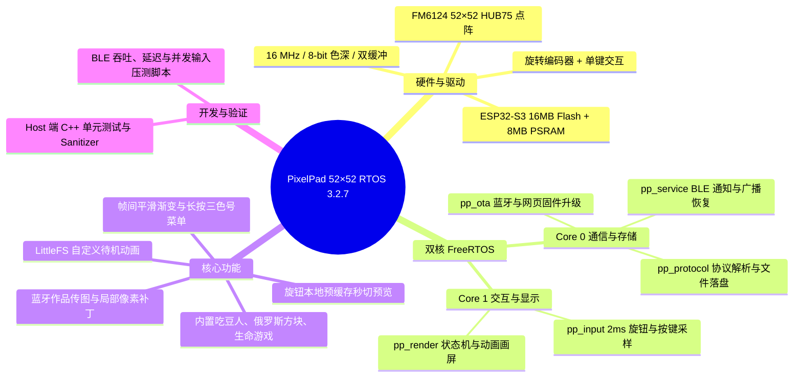
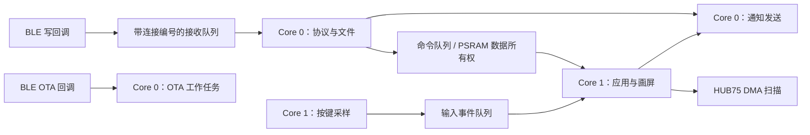

# PixelPad RTOS（ESP32-S3，52×52）

这是 PixelPad 52×52 点阵屏（ESP32-S3 + FM6124）的开源固件工程，刷入后即可直接用配套 App 蓝牙连接。

底层基于 **ESP-IDF FreeRTOS**，保留了 Arduino 2.0.17 作为驱动兼容层，把早期的单线程主循环拆成了独立的 FreeRTOS 任务。当前版本为 **3.2.7**，支持本地旋钮作品预览、切图渐变、有序输入队列、OTA 传输互斥以及长按三色号菜单；默认跑在 FM6124 驱动、16 MHz 时钟、8 bit 色深和双缓冲配置下。

如果你想了解各个版本的演进细节和实板测试数据，可以翻看 `docs/` 目录下的记录：
- [旋钮预览与交互集成记录](docs/ROTARY_PREVIEW_PORT.md)（3.2.7）
- [8 bit 色深恢复说明](docs/COLOR_RESTORE.md)（3.2.5）
- [高刷配置与实板验证](docs/HIGH_REFRESH_VALIDATION.md)（3.2.4）
- [RTOS 架构设计与瓶颈分析](docs/RTOS_REVIEW.md)

## 分支说明

| 分支 | 目标硬件与驱动 | 当前版本 |
| --- | --- | --- |
| `main` | ESP32-S3 + 52×52 **FM6124**（HUB75 I2S DMA 位平面驱动） | RTOS 3.2.7 |
| `52x52-fm6373c` | ESP32-S3 + 52×52 **FM6373C**（8 MHz 内部 PWM + PSRAM LCD_CAM/GDMA 驱动） | RTOS 3.3.5 |

日常针对 FM6124 版本的修改请直接基于 `main` 提 PR，具体约定见 [CONTRIBUTING.md](CONTRIBUTING.md)。

## 目录结构



| 目录/文件 | 内容 |
| --- | --- |
| `src/main.cpp` | 固件入口、任务创建和系统初始化 |
| `include/` | 显示、协议和运行时公共头文件 |
| `lib/app/` | 应用模式、游戏和待机逻辑 |
| `lib/Bluetooth/` | BLE NUS、命令解析和连接会话 |
| `lib/OTA/` | BLE/HTTP OTA、写入和升级状态 |
| `lib/led/` | HUB75 显示、帧提交和亮度策略 |
| `lib/button/` | 按键、旋钮采样与事件队列 |
| `test/`、`tools/` | 主机回归测试和 BLE 测量脚本 |

第一次看代码建议先扫一眼 [platformio.ini](platformio.ini) 里的环境配置，再看 [BLE_PROTOCOL.md](BLE_PROTOCOL.md) 和 [RTOS 评审](docs/RTOS_REVIEW.md)。

## 编译与烧录

使用 PlatformIO 即可直接编译默认固件：

```sh
pio run -e pixelpad_s3_rtos
```

编译产物在 `.pio/build/pixelpad_s3_rtos/firmware.bin`。

硬件配置上，工程针对 16 MB Flash + 8 MB OPI PSRAM 的 ESP32-S3 模组（52×52 映射、FM6124 驱动、双 OTA 分区）。RGB 暂存帧放在 PSRAM，HUB75 DMA 缓冲留在片内 SRAM；串口日志走 UART0（115200，适配板载 CH340），烧录波特率设为 460800。

除了默认的 `pixelpad_s3_rtos`（16 MHz / 8 bit / 双缓冲，理论刷新率约 303 Hz），`platformio.ini` 里还保留了几个调试对比环境：
- `pixelpad_s3_refresh_fast`：4 bit 色深，理论刷新率约 1076 Hz
- `pixelpad_s3_refresh_safe`：10 MHz 时钟 / 4 bit 色深，理论刷新率约 672 Hz
- `pixelpad_s3_color`：旧版色彩与扫描参数（约 104 Hz）
- `pixelpad_s3_ble_only`：关闭常驻 Wi-Fi AP 和 HTTP OTA，仅保留 BLE 与 BLE OTA，方便做无线干扰对比测试

```sh
pio run -e pixelpad_s3_ble_only
```

接好串口线后烧录并查看启动日志：

```sh
pio run -e pixelpad_s3_rtos -t upload --upload-port /dev/你的串口
pio device monitor -b 115200 -p /dev/你的串口
```

全新的空片第一次刷机时，如果需要初始化 LittleFS 文件系统分区，可以手动执行下面的命令（**注意：这会覆盖整个文件系统分区，清空设备里已保存的自定义待机动画**，平时升级固件不需要跑）：

```sh
pio run -e pixelpad_s3_rtos -t uploadfs --upload-port /dev/你的串口
```

## FreeRTOS 任务划分

| 任务 | 核 | 优先级 | 栈申请（字节） | 工作 |
| --- | --- | --- | --- | --- |
| `pp_input` | 1 | 4 | 3072 | 每 2 ms 扫描按键/旋钮，仅投递事件 |
| `pp_render` | 1 | 2 | 12288 | 消费输入/命令，独占 App、游戏和 LED 写入 |
| `pp_protocol` | 0 | 3 | 8192 | BLE 字节流、JSON、图片/动画接收、待机文件、名称保存 |
| `pp_service` | 0 | 1 | 6144 | NUS 通知发送、延后恢复广播、HTTP OTA 维护 |
| `pp_ota` | 0 | 3 | 10240 | BLE OTA 命令、Flash、CRC 和升级状态 |

核心思路是把重 IO 的协议/Flash 操作留在 Core 0，把决定手感和画面的输入采样与渲染放在 Core 1。`pp_input` 只管高频采样和塞队列，不碰 Flash、不发蓝牙通知也不做内存分配；HUB75 面板刷新由底层 I2S DMA 持续驱动，`pp_render` 负责更新帧缓冲。



## 蓝牙协议说明

固件完全兼容 PixelPad 现有的 BLE UUID、广播识别码、工作模式、亮度调节、像素补丁、旋钮上报、改名以及 BLE OTA 流程，配套 App 可以直接扫描连接。

完整的协议字段请看 [BLE_PROTOCOL.md](BLE_PROTOCOL.md)，实际联调时注意以下几点：
- **流式接收不要插队**：NUS RX 是单条按序字节流。在发送图片或动画的二进制数据时，中间不要穿插新的 JSON 命令，等收到本帧回应后再发下一条。
- **收完再画，不卡交互**：传图过程中屏幕会保持上一帧画面，同时本地旋钮、按键和内置小游戏照常响应，整帧收齐校验通过后才会切图并回复 `{"cmd":"recv","status":"ok"}`。
- **自定义待机动画**：最多支持 256 帧、1–60 FPS，`size` 必须严格等于 `frames × 8112`。设备申请好缓存后会先回 `READY`，落盘并交给渲染任务后再回 `OK`。
- **异常断流重连**：如果遇到缓冲区溢出或图片传输超时（返回 `rx_desync_reconnect` 或 `recv_fail`），建议直接断开重连，再从头发送完整指令。
- **OTA 独占**：BLE OTA 升级期间会自动挂起普通业务指令和画面更新，确保刷写稳定。

## 本地测试与调试工具

不需要连硬件，在电脑上就能直接跑完核心逻辑的回归测试（协议解析、帧过渡、旋钮缓存、色盘状态机、生命游戏重绘等）：

```sh
python tools/test_host.py
# 如果本机装了 Clang，也可以加上 Address/UB Sanitizer 跑一遍
CXX=clang++ python tools/test_host.py --sanitize
```

连上真机后，可以通过蓝牙发送一条换行结尾的 JSON 来查看 RTOS 实时水位（队列耗时、帧渲染耗时、剩余堆与各任务栈水位）：

```json
{"cmd":"rtos_stats"}
```

`tools/` 下还带了几个基于 `bleak` 的蓝牙压测脚本（注意 `image` 和 `input` 模式会在屏幕上画测试图）：

```sh
python tools/ble_benchmark.py --address 设备BLE地址 --mode stats --iterations 20
python tools/ble_benchmark.py --address 设备BLE地址 --mode image --iterations 100
python tools/ble_benchmark.py --address 设备BLE地址 --mode input --iterations 1
```

更多实板测试记录可以参考 [VALIDATION.md](docs/VALIDATION.md)。

## 开源许可与使用说明

本项目使用与授权条款见 [OPEN_SOURCE_USAGE.md](OPEN_SOURCE_USAGE.md)，所依赖的第三方库遵循各自原有的开源许可。
