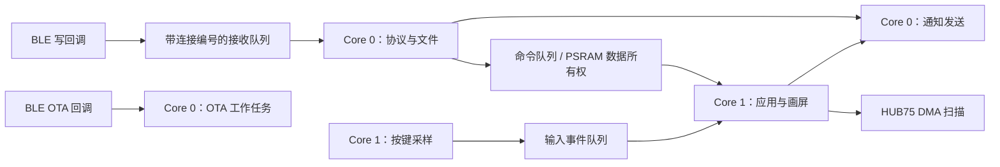

# PixelPad RTOS（ESP32-S3，52×52）

从 `../PixelPad_52x52` 当前工作区迁移的独立固件工程。选择 **ESP-IDF FreeRTOS**，保留 Arduino 2.0.17 作为驱动兼容层，用显式任务替代原来的串行业务主循环。版本标识为 **3.2.3**，已完成串口烧录与初步上板测试；详细范围见验证记录。

选择理由、原代码瓶颈、任务设计和性能验收条件见 [RTOS 评审](docs/RTOS_REVIEW.md)。原工程文件未修改；迁移输入的校验值见 [source-sha256.json](docs/source-sha256.json)。复制的是工作区实际内容，包含原工程已有的未提交修改，不是仅复制某个 Git 提交。

## 构建

```sh
cd PixelPad_RTOS
pio run -e pixelpad_s3_rtos
```

固件输出：`.pio/build/pixelpad_s3_rtos/firmware.bin`。继续使用原来的 16 MB Flash / 8 MB OPI PSRAM 板型、52×52 映射、FM6124 配置、8 MHz HUB75 时钟、亮度限幅和双 OTA 分区。串口日志使用 UART0（115200），适配当前连接的 CH340 USB 转串口；关闭板定义默认的 USB CDC 日志路由。烧录速度降为实测链路可用的 460800。此工程面向 52×52 FM6124 硬件。

可选 BLE 专用构建关闭常驻 Wi-Fi 热点和 HTTP OTA，用于与默认环境进行 A/B 对比；BLE OTA 保留：

```sh
pio run -e pixelpad_s3_ble_only
```

手动确认目标板与接线后烧录：

```sh
pio run -e pixelpad_s3_rtos -t upload --upload-port /dev/你的串口
pio device monitor -b 115200 -p /dev/你的串口
```

不要将构建成功当作硬件验收通过。首次上电应确认启动日志中任务创建成功、PSRAM 可用、显示映射正确，并检查运行时堆和栈余量。

## 任务与所有权

| 任务 | 核 | 优先级 | 栈申请（字节） | 工作 |
| --- | --- | --- | --- | --- |
| `pp_input` | 1 | 4 | 3072 | 每 2 ms 扫描按键/旋钮，仅投递事件 |
| `pp_render` | 1 | 2 | 12288 | 消费输入/命令，独占 App、游戏和 LED 写入 |
| `pp_protocol` | 0 | 3 | 8192 | BLE 字节流、JSON、图片/动画接收、待机文件、名称保存 |
| `pp_service` | 0 | 1 | 6144 | NUS 通知发送、延后恢复广播、HTTP OTA 维护 |
| `pp_ota` | 0 | 3 | 10240 | BLE OTA 命令、Flash、CRC 和升级状态 |

ESP-IDF 自带的 Wi-Fi/BLE/系统任务继续存在。显示扫描由 HUB75 DMA 执行；`pp_render` 更新像素内容。输入任务没有 Flash 写入、BLE Notify、画屏或动态内存分配。任务周期和优先级是实现配置，不是实测响应时间保证。



## 协议兼容与限制

UUID、PixelPad 型号识别、模式、亮度、像素补丁、旋钮事件、名称和 BLE OTA 协议保留。图片 ACK 现在带 `cmd:recv`，保留 `status:ok`；增加文档已有的 `cmd:key` 处理，同时兼容 `game`/`key` 形式。

详细约束见 [BLE_PROTOCOL.md](BLE_PROTOCOL.md) 的 RTOS 补充，尤其是：

- 同一 NUS RX 是一个按序字节流。发送二进制正文时不能插入另一条 JSON 命令；发送端仍需串行化写入。收到旋钮 TX 事件并不意味着可以在尚未结束的图片正文里发送新图片。
- 图片接收保留上一帧，完整接收后才绘制并 ACK；接收过程允许本地输入、游戏和后台任务继续运行。
- 自定义待机动画最多 256 帧、1–60 FPS，`size` 必须精确等于 `frames × 8112`。先分配成功才发 READY；文件写入成功并移交显示任务后才发 OK。
- 溢出、图片接收失败会使当前 RX 会话失去同步：收到 `rx_desync_reconnect` 或 `recv_fail` 后重新连接，再从完整命令开始发送。旧协议没有二进制帧边界或图片 CRC，不能安全地把残余数据当作 JSON 重试。
- BLE OTA 期间暂停业务处理；输入仍被采样但事件丢弃。升级应单通道进行，HTTP OTA、BLE OTA 与媒体写入的并发组合尚未做硬件验收。

待机文件继续使用原 `standby.bin` 格式。新代码不在挂载失败时自动格式化，避免抹除已有内容。空白板需要先初始化 LittleFS；以下操作**会替换整个文件系统分区，清除已保存的待机内容**，仅在确实需要时手动执行：

```sh
pio run -e pixelpad_s3_rtos -t uploadfs --upload-port /dev/你的串口
```

## 验证和测量

不连接设备的回归检查：

```sh
python tools/test_host.py
# 可选：本机已安装 Clang 和 sanitizer runtime 时
CXX=clang++ python tools/test_host.py --sanitize
```

覆盖 JSON 分片/超长行/正文边界、待机参数与溢出边界、亮度策略，以及生命游戏静止时跳过整屏重绘、输入和闪烁仍正常。

设备新增查询：

```json
{"cmd":"rtos_stats"}
```

发送时追加换行。返回输入/命令处理次数、输入队列最大等待、命令队列最大等待、渲染循环最大耗时、溢出计数、堆和各任务剩余栈；详细单位见协议补充。统计不是 GPIO 到屏幕发光的端到端测量。

手动 BLE 测量脚本需要 `bleak`，建议在虚拟环境安装。`image`/`input` 模式会将显示画面替换为低亮度测试图：

```sh
python tools/ble_benchmark.py --address 设备BLE地址 --mode stats --iterations 20
python tools/ble_benchmark.py --address 设备BLE地址 --mode image --iterations 100
python tools/ble_benchmark.py --address 设备BLE地址 --mode input --iterations 1
```

`input` 模式会在图片发送一半时暂停 2 秒，此时手动转动旋钮/操作按键；脚本报告是否在正文尚未传完时收到输入事件。`image` 模式兼容旧工程的无 `cmd` ACK，可在同一设备上对比中位数/P95。实际传输长度受主机协商 MTU 限制，脚本不会强制声称已协商到 517。

当前验证记录见 [VALIDATION.md](docs/VALIDATION.md)。这些脚本不会自动烧录固件。

## 使用与授权

保留迁移源的 [使用与授权说明](OPEN_SOURCE_USAGE.md) 和各第三方库许可。这个目录的建立不改变原工程或第三方库的授权条件。
